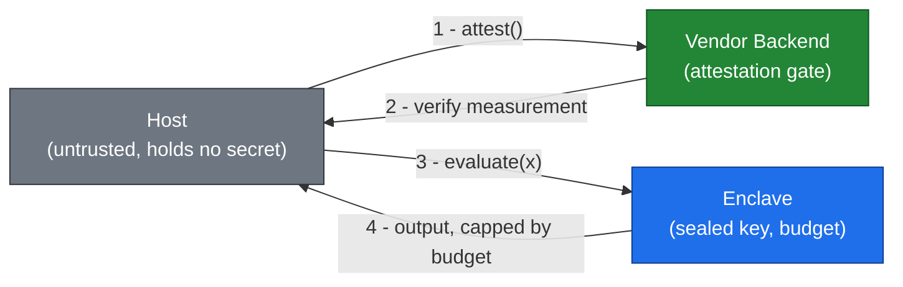

<div align="center">

# clave

### Keep proprietary logic on the client without giving it away

Protect a function that must run on the user's machine, using a Trusted
Execution Environment boundary, attestation, and a query budget. Pure Python,
zero dependencies, fully tested.

[](LICENSE)
[](https://www.python.org/)
[](https://github.com/andreahlert/clave/actions/workflows/ci.yml)
[](pyproject.toml)
[](https://github.com/andreahlert/clave/pulls)

</div>

---

## Why this exists

Code that runs entirely on hardware the vendor does not control can be studied
freely. For a deterministic function with a samplable input space, an
independent reimplementation that reproduces the input/output behavior is
enough to copy the functionality. Making the binary complex does not help:
execution cost is **orthogonal** to how hard the behavior is to learn from
samples. A virtual machine that is 1000x slower is no harder to clone than a
plain loop, because a cloner only needs the outputs, not the code path.

See Barak et al., [On the (Im)possibility of Obfuscating Programs](https://www.iacr.org/archive/crypto2001/21390001.pdf),
and the [Man-At-The-End](https://en.wikipedia.org/wiki/Trusted_execution_environment) threat model.

## How it works

`clave` implements the **Attested Split Oracle** pattern. Three layers, each
mapping to a real [TEE](https://en.wikipedia.org/wiki/Trusted_execution_environment) feature.



| Layer | What it does | Real TEE mechanism |
|-------|--------------|--------------------|
| **Encapsulation** | The key-bearing core runs behind a boundary; the key is never readable by the host | Hardware memory isolation |
| **Attestation** | The core proves it runs the expected code before any secret is released | Signed measurement verified by the vendor backend |
| **Query budget** | The number of input/output pairs that can be collected is capped | Attested key-release policy |

The core is a **keyed function** whose output is indistinguishable from random
without the key. That is the crux: its behavior cannot be generalized from
observed pairs, so the only option is to memorize pairs actually queried,
which the budget limits.

## Quickstart

```python
from clave import Enclave, Backend, Host

enclave = Enclave(sealed_key=my_32_byte_key, max_queries=5000)
host = Host(enclave, Backend())   # raises if attestation fails
result = host.run(42)             # computes without exposing the key
```

## See it work

```bash
python examples/demo.py
```

```text
input space ......... 16,777,216 possible inputs
held-out test set ... 10,000 unseen inputs
query budget ........ 5,000 calls per session

A) local key in client ...... clone matches 100.0% of held-out
B) clave (enclave + budget) . clone matches 0.060% of held-out (after 5,000 queries)
   legit user with budget ... computes      100.0% of held-out

verdict: local-only leaks everything; clave keeps behavior PROTECTED
```

A local key copies **100%** of the behavior. The same function behind `clave`
leaks **0.06%**, while the real user still computes **100%** correctly.

## Tests

```bash
pip install -e ".[dev]"
pytest -v
```

Eight tests cover all three layers: correctness, key confidentiality, rate
limiting, attestation refusal, a sampled clone failing on held-out inputs, and
the contrast case where an unprotected local key is fully clonable.

## Simulation vs. hardware

This repo emulates the enclave boundary in pure Python so the pattern runs and
tests on any machine. The security argument is identical to hardware; only the
enforcement differs. To deploy for real, replace the body of `Enclave._core`
with your logic and run it inside an actual TEE.

| Target | Options |
|--------|---------|
| **Server / B2B** | [AWS Nitro Enclaves](https://docs.aws.amazon.com/enclaves/latest/user/nitro-enclave.html), [Azure Confidential Computing](https://learn.microsoft.com/en-us/azure/confidential-computing/overview), [Google Confidential Space](https://cloud.google.com/confidential-computing/confidential-space/docs/confidential-space-overview) |
| **Desktop** | [Open Enclave SDK](https://github.com/openenclave/openenclave), [Apache Teaclave](https://github.com/apache/incubator-teaclave-sgx-sdk) |
| **Mobile** | [Apple Secure Enclave](https://developer.apple.com/documentation/cryptokit/secureenclave), [Android StrongBox](https://developer.android.com/privacy-and-security/keystore) |

## Honest limits

- The boundary protects the **core**, not the input/output at its edges. Put
  inside only the step that, when missing, turns the output into noise.
- Real TEEs have a side-channel history ([Foreshadow](https://foreshadowattack.eu/),
  [Plundervolt](https://plundervolt.com/)). Good against a competitor or a
  pirate, not a guarantee against a state-level effort.
- Attestation needs a vendor backend. This moves a small verification step off
  the client, not the algorithm itself.
- Pair it with legal protection (copyright, patent, contract) and watermarking
  for what the technical layer does not cover.

## License

[MIT](LICENSE) &copy; 2026 Andre Ahlert
